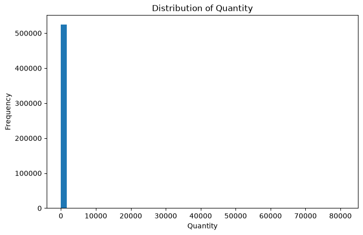
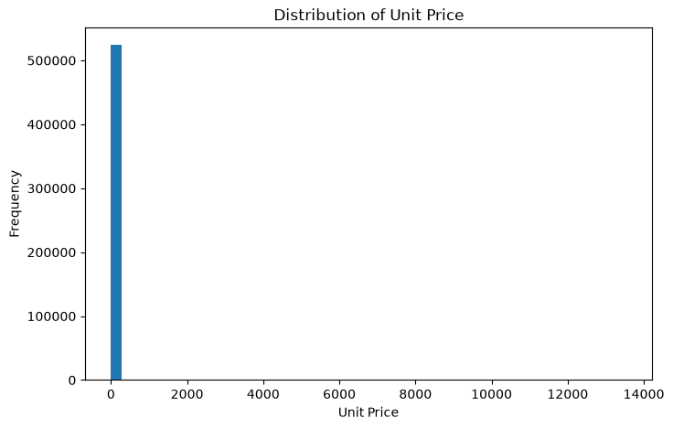
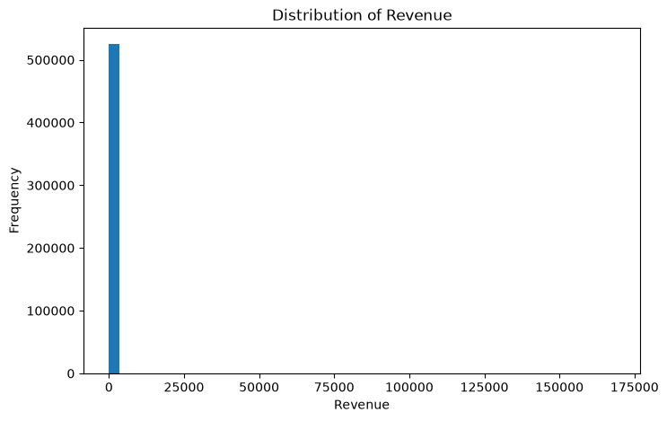
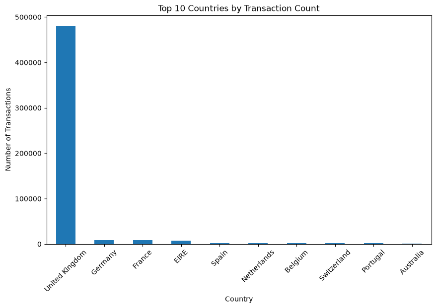

# Online Retail Sales Analysis

## 02 - Exploratory Data Analysis

### Objective

The objective of this notebook is to explore the cleaned online
retail sales dataset and understand its overall structure,
distribution, and major patterns before performing detailed
sales, customer, and product analysis.

### Key Areas

- Dataset overview
- Data distribution
- Overall sales performance
- Time-based patterns
- Country-level patterns
- Initial business observations


```python
import pandas as pd
import numpy as np
import matplotlib.pyplot as plt
```


```python
# Load the cleaned dataset
df = pd.read_csv(r"C:\Users\ankit\OneDrive\Desktop\Ecommerse Sales Analysis\Data/Processed/clean_sales_data.csv")
```

    C:\Users\ankit\AppData\Local\Temp\ipykernel_8772\761483765.py:2: DtypeWarning: Columns (0: InvoiceNo) have mixed types. Specify dtype option on import or set low_memory=False.
      df = pd.read_csv(r"C:\Users\ankit\OneDrive\Desktop\Ecommerse Sales Analysis\Data/Processed/clean_sales_data.csv")
    


```python
df["InvoiceDate"] = pd.to_datetime(df["InvoiceDate"])
```


```python
df.head()
```


<div>
<style scoped>
    .dataframe tbody tr th:only-of-type {
        vertical-align: middle;
    }

    .dataframe tbody tr th {
        vertical-align: top;
    }

    .dataframe thead th {
        text-align: right;
    }
</style>
<table border="1" class="dataframe">
  <thead>
    <tr style="text-align: right;">
      <th></th>
      <th>InvoiceNo</th>
      <th>StockCode</th>
      <th>Description</th>
      <th>Quantity</th>
      <th>InvoiceDate</th>
      <th>UnitPrice</th>
      <th>CustomerID</th>
      <th>Country</th>
      <th>Revenue</th>
    </tr>
  </thead>
  <tbody>
    <tr>
      <th>0</th>
      <td>536365</td>
      <td>85123A</td>
      <td>WHITE HANGING HEART T-LIGHT HOLDER</td>
      <td>6</td>
      <td>2010-12-01 08:26:00</td>
      <td>2.55</td>
      <td>17850.0</td>
      <td>United Kingdom</td>
      <td>15.30</td>
    </tr>
    <tr>
      <th>1</th>
      <td>536365</td>
      <td>71053</td>
      <td>WHITE METAL LANTERN</td>
      <td>6</td>
      <td>2010-12-01 08:26:00</td>
      <td>3.39</td>
      <td>17850.0</td>
      <td>United Kingdom</td>
      <td>20.34</td>
    </tr>
    <tr>
      <th>2</th>
      <td>536365</td>
      <td>84406B</td>
      <td>CREAM CUPID HEARTS COAT HANGER</td>
      <td>8</td>
      <td>2010-12-01 08:26:00</td>
      <td>2.75</td>
      <td>17850.0</td>
      <td>United Kingdom</td>
      <td>22.00</td>
    </tr>
    <tr>
      <th>3</th>
      <td>536365</td>
      <td>84029G</td>
      <td>KNITTED UNION FLAG HOT WATER BOTTLE</td>
      <td>6</td>
      <td>2010-12-01 08:26:00</td>
      <td>3.39</td>
      <td>17850.0</td>
      <td>United Kingdom</td>
      <td>20.34</td>
    </tr>
    <tr>
      <th>4</th>
      <td>536365</td>
      <td>84029E</td>
      <td>RED WOOLLY HOTTIE WHITE HEART.</td>
      <td>6</td>
      <td>2010-12-01 08:26:00</td>
      <td>3.39</td>
      <td>17850.0</td>
      <td>United Kingdom</td>
      <td>20.34</td>
    </tr>
  </tbody>
</table>
</div>


```python
df.shape
```


    (524878, 9)


```python
df.info()
```

    <class 'pandas.DataFrame'>
    RangeIndex: 524878 entries, 0 to 524877
    Data columns (total 9 columns):
     #   Column       Non-Null Count   Dtype         
    ---  ------       --------------   -----         
     0   InvoiceNo    524878 non-null  object        
     1   StockCode    524878 non-null  str           
     2   Description  524878 non-null  str           
     3   Quantity     524878 non-null  int64         
     4   InvoiceDate  524878 non-null  datetime64[us]
     5   UnitPrice    524878 non-null  float64       
     6   CustomerID   392692 non-null  float64       
     7   Country      524878 non-null  str           
     8   Revenue      524878 non-null  float64       
    dtypes: datetime64[us](1), float64(3), int64(1), object(1), str(3)
    memory usage: 58.6+ MB
    


```python
df.describe()
```


<div>
<style scoped>
    .dataframe tbody tr th:only-of-type {
        vertical-align: middle;
    }

    .dataframe tbody tr th {
        vertical-align: top;
    }

    .dataframe thead th {
        text-align: right;
    }
</style>
<table border="1" class="dataframe">
  <thead>
    <tr style="text-align: right;">
      <th></th>
      <th>Quantity</th>
      <th>InvoiceDate</th>
      <th>UnitPrice</th>
      <th>CustomerID</th>
      <th>Revenue</th>
    </tr>
  </thead>
  <tbody>
    <tr>
      <th>count</th>
      <td>524878.000000</td>
      <td>524878</td>
      <td>524878.000000</td>
      <td>392692.000000</td>
      <td>524878.000000</td>
    </tr>
    <tr>
      <th>mean</th>
      <td>10.616600</td>
      <td>2011-07-04 15:30:16.317049</td>
      <td>3.922573</td>
      <td>15287.843865</td>
      <td>20.275399</td>
    </tr>
    <tr>
      <th>min</th>
      <td>1.000000</td>
      <td>2010-12-01 08:26:00</td>
      <td>0.001000</td>
      <td>12346.000000</td>
      <td>0.001000</td>
    </tr>
    <tr>
      <th>25%</th>
      <td>1.000000</td>
      <td>2011-03-28 12:13:00</td>
      <td>1.250000</td>
      <td>13955.000000</td>
      <td>3.900000</td>
    </tr>
    <tr>
      <th>50%</th>
      <td>4.000000</td>
      <td>2011-07-20 11:22:00</td>
      <td>2.080000</td>
      <td>15150.000000</td>
      <td>9.920000</td>
    </tr>
    <tr>
      <th>75%</th>
      <td>11.000000</td>
      <td>2011-10-19 11:41:00</td>
      <td>4.130000</td>
      <td>16791.000000</td>
      <td>17.700000</td>
    </tr>
    <tr>
      <th>max</th>
      <td>80995.000000</td>
      <td>2011-12-09 12:50:00</td>
      <td>13541.330000</td>
      <td>18287.000000</td>
      <td>168469.600000</td>
    </tr>
    <tr>
      <th>std</th>
      <td>156.280031</td>
      <td>NaN</td>
      <td>36.093028</td>
      <td>1713.539549</td>
      <td>271.693566</td>
    </tr>
  </tbody>
</table>
</div>


```python
df.dtypes
```


    InvoiceNo              object
    StockCode                 str
    Description               str
    Quantity                int64
    InvoiceDate    datetime64[us]
    UnitPrice             float64
    CustomerID            float64
    Country                   str
    Revenue               float64
    dtype: object


```python
df.isnull().sum()
```


    InvoiceNo           0
    StockCode           0
    Description         0
    Quantity            0
    InvoiceDate         0
    UnitPrice           0
    CustomerID     132186
    Country             0
    Revenue             0
    dtype: int64


```python
summary = pd.DataFrame({
    "Metric": [
        "Total Transactions",
        "Total Columns",
        "Unique Invoices",
        "Unique Products",
        "Unique Customers",
        "Countries"
    ],
    "Value": [
        len(df),
        df.shape[1],
        df["InvoiceNo"].nunique(),
        df["StockCode"].nunique(),
        df["CustomerID"].nunique(),
        df["Country"].nunique()
    ]
})

summary
```


<div>
<style scoped>
    .dataframe tbody tr th:only-of-type {
        vertical-align: middle;
    }

    .dataframe tbody tr th {
        vertical-align: top;
    }

    .dataframe thead th {
        text-align: right;
    }
</style>
<table border="1" class="dataframe">
  <thead>
    <tr style="text-align: right;">
      <th></th>
      <th>Metric</th>
      <th>Value</th>
    </tr>
  </thead>
  <tbody>
    <tr>
      <th>0</th>
      <td>Total Transactions</td>
      <td>524878</td>
    </tr>
    <tr>
      <th>1</th>
      <td>Total Columns</td>
      <td>9</td>
    </tr>
    <tr>
      <th>2</th>
      <td>Unique Invoices</td>
      <td>19962</td>
    </tr>
    <tr>
      <th>3</th>
      <td>Unique Products</td>
      <td>3922</td>
    </tr>
    <tr>
      <th>4</th>
      <td>Unique Customers</td>
      <td>4338</td>
    </tr>
    <tr>
      <th>5</th>
      <td>Countries</td>
      <td>38</td>
    </tr>
  </tbody>
</table>
</div>


<h1>Numerical Columns Identify </h1>


```python
# Select numerical columns
numerical_columns = df.select_dtypes(include="number").columns

numerical_columns
```


    Index(['Quantity', 'UnitPrice', 'CustomerID', 'Revenue'], dtype='str')


```python
numerical_columns = ["Quantity", "UnitPrice", "Revenue"]
```


```python
# Statistical summary of numerical variables
df[numerical_columns].describe()
```


<div>
<style scoped>
    .dataframe tbody tr th:only-of-type {
        vertical-align: middle;
    }

    .dataframe tbody tr th {
        vertical-align: top;
    }

    .dataframe thead th {
        text-align: right;
    }
</style>
<table border="1" class="dataframe">
  <thead>
    <tr style="text-align: right;">
      <th></th>
      <th>Quantity</th>
      <th>UnitPrice</th>
      <th>Revenue</th>
    </tr>
  </thead>
  <tbody>
    <tr>
      <th>count</th>
      <td>524878.000000</td>
      <td>524878.000000</td>
      <td>524878.000000</td>
    </tr>
    <tr>
      <th>mean</th>
      <td>10.616600</td>
      <td>3.922573</td>
      <td>20.275399</td>
    </tr>
    <tr>
      <th>std</th>
      <td>156.280031</td>
      <td>36.093028</td>
      <td>271.693566</td>
    </tr>
    <tr>
      <th>min</th>
      <td>1.000000</td>
      <td>0.001000</td>
      <td>0.001000</td>
    </tr>
    <tr>
      <th>25%</th>
      <td>1.000000</td>
      <td>1.250000</td>
      <td>3.900000</td>
    </tr>
    <tr>
      <th>50%</th>
      <td>4.000000</td>
      <td>2.080000</td>
      <td>9.920000</td>
    </tr>
    <tr>
      <th>75%</th>
      <td>11.000000</td>
      <td>4.130000</td>
      <td>17.700000</td>
    </tr>
    <tr>
      <th>max</th>
      <td>80995.000000</td>
      <td>13541.330000</td>
      <td>168469.600000</td>
    </tr>
  </tbody>
</table>
</div>


<h1>Quantity Distribution</h1>


```python
plt.figure(figsize=(8, 5))

plt.hist(df["Quantity"], bins=50)

plt.title("Distribution of Quantity")
plt.xlabel("Quantity")
plt.ylabel("Frequency")

plt.show()
```


    

    


<h1>Unit Price Distribution</h1>


```python
plt.figure(figsize=(8, 5))

plt.hist(df["UnitPrice"], bins=50)

plt.title("Distribution of Unit Price")
plt.xlabel("Unit Price")
plt.ylabel("Frequency")

plt.show()
```


    

    


<h1>Revenue Distribution</h1>


```python
plt.figure(figsize=(8, 5))

plt.hist(df["Revenue"], bins=50)

plt.title("Distribution of Revenue")
plt.xlabel("Revenue")
plt.ylabel("Frequency")

plt.show()
```


    

    


<h1>Categorical Columns</h1>


```python
categorical_columns = df.select_dtypes(include="object").columns

categorical_columns
```

    C:\Users\ankit\AppData\Local\Temp\ipykernel_8772\1797605437.py:1: Pandas4Warning: For backward compatibility, 'str' dtypes are included by select_dtypes when 'object' dtype is specified. This behavior is deprecated and will be removed in a future version. Explicitly pass 'str' to `include` to select them, or to `exclude` to remove them and silence this warning.
    See https://pandas.pydata.org/docs/user_guide/migration-3-strings.html#string-migration-select-dtypes for details on how to write code that works with pandas 2 and 3.
      categorical_columns = df.select_dtypes(include="object").columns
    


    Index(['InvoiceNo', 'StockCode', 'Description', 'Country'], dtype='str')


```python
categorical_columns = ["Country", "Description"]
```

<h1>Country Distribution</h1>


```python
country_counts = df["Country"].value_counts()

country_counts.head(10)
```


    Country
    United Kingdom    479985
    Germany             9025
    France              8392
    EIRE                7879
    Spain               2479
    Netherlands         2359
    Belgium             2031
    Switzerland         1958
    Portugal            1492
    Australia           1181
    Name: count, dtype: int64


```python
plt.figure(figsize=(10, 6))

country_counts.head(10).plot(kind="bar")

plt.title("Top 10 Countries by Transaction Count")
plt.xlabel("Country")
plt.ylabel("Number of Transactions")

plt.xticks(rotation=45)

plt.show()
```


    

    


```python

```
